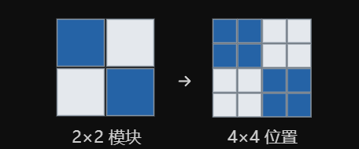

## 二、44×44 已经有了，为什么接下来又会出现 42×42？

现在我们要把二维码放进去。

先来看 SFWMark 原论文的 HSQR 部分。作者没有直接拿一张任意大小的二维码嵌入，而是使用 Version 1 QR Code。

它的基本结构是：

\[ 21\times21 \]

也就是说，二维码包含 21 行、21 列的基本模块（module）。

每个模块可以理解为一个黑白方块。

原论文又做了一件事情：把每个二维码模块扩展成 2×2 个位置。目的是通过空间上的重复表示增加冗余，使信息能够在受到扰动后更容易被恢复。

例如，一个只有四个模块的小图案：

2×2 模块

4×4 位置

同样的操作应用到真正的 21×21 二维码：

\[ 21\times2=42 \]

于是得到：

\[ \boxed{\text{QR 图案：}42\times42} \]

到这里，你已经知道：

- 44×44 是潜变量的中央空间区域。
- 42×42 是经过 2 倍模块扩展的二维码图案。

它们代表的不是同一个东西。

不过，这时候又产生一个新问题：

我们有一个 42×42 的二维码，而傅里叶变换产生的是复数系数。该怎样把二维码的黑白信息放进复数里面？

这才是 42×21 出现的真正原因。

接下来，对于原来的图片是44*44，通过rfft2变成44/2+1=23

第一，频率坐标的第 0 列是一个特殊轴。原论文解释，为了避免 DC 轴附近的厄米对称约束与数值问题，HSQR 的嵌入选区向右偏移一个位置。

第二，实际选区只占 42 行，未占用 44 行频谱的所有位置；水印图案本身的高度就是 42。

所以，42×21 不是 FFT 自动输出的形状，而是根据 HSQR 水印图案的大小、位置及频率约束选出的具体区域。

# 44×44 是变换前的空间区域；44×23 是实输入 FFT 的半频谱；42×21 才是从中挑出的水印频率区域。